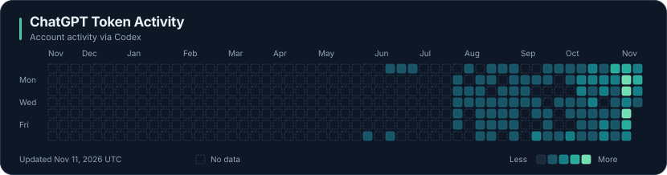

### 👋 About Me

- 🦆 I'm a **PhD student in Computer Science at University College London (UCL)**.
- 🎓 Previously, I earned my **Bachelor's degree from Peking University (PKU)**.
- 🧐 I'm particularly interested in **LLMs, RAG, PEFT and multi-agent reasoning**.
- 🎾 Outside research, I enjoy playing **tennis**.

### 🏅 Kaggle

I enjoy hands-on machine learning challenges, from applied prediction to scientific discovery. [Explore my Kaggle profile](https://www.kaggle.com/wonduk).

Daily activity, shown as colors only. Outlined dates have no reported data.

---

  <em>Always curious about how to make AI systems more capable, reliable, and useful.</em>

